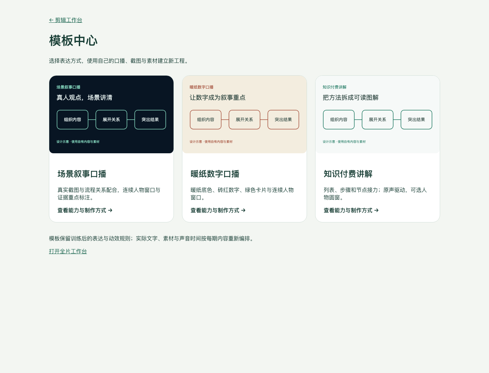

# Presenter Video Studio · 剪辑工作台与知识讲解模板中心

> **测试中，尚非正式版。** 当前不提供正式 GitHub Release。测试时请使用 Code → Download ZIP 获取源码，解压后按说明安装。文中的版本号用于区分测试构建，不代表正式验收；独立安装包与 Skill 包仍保留在作者本地。

本地运行的 AI 辅助视频制作工具，包含可编辑剪辑工作台、模板中心与可独立导入的 Skill。支持 WorkBuddy、Codex 等具备本地文件和命令执行能力的桌面助手接入。AI 组织内容与编排，工作台保存工程、预览并原生导出。

## 当前测试构建：2026.11.5-r2

新增首次默认/自定标准选择和持久保存；用户自建模板与动态模板发现；可重复发布打包工具。四项核验见 [核验记录](docs/四项逻辑核验.md)。

原有工作台能力：

- 同步当前工作台：字幕、人物布局、代码图解、素材、音频、草稿与导出功能。
- 模板名称统一为「知识付费讲解」「知识付费参考研究」。内部标识保留，旧工程继续识别。
- 默认模板中心仅显示三个制作入口，去掉原有开发演示、参考原片与重复版本卡片。
- 加入场景叙事的证据卡与手册图解能力、暖纸参数化版式、可选人物圆窗和分层渲染能力。
- 附独立 Skill 包与 WorkBuddy 接入指南；不包含私人素材、草稿、成片、第三方参考视频或账号凭证。

## 能力范围

| 能力 | 说明 |
|---|---|
| 口播与字幕 | 导入原视频和同版本 SRT，按语义短句编排、突出关键词；可配置本地识别 |
| 可编辑画面 | 文字、卡片、关系图、数字、截图、视频素材与人物窗口 |
| 声音 | 人声、BGM、音效独立编排；支持淡化、循环及相应混音流程 |
| 工程与修订 | 本地素材库、草稿保存、JSON 工程、按原工程继续修改 |
| 原生导出 | MP4；macOS 配备编译工具后可导出透明 MOV |
| AI 接入 | Skill 提供分镜、素材、模板、质检流程；可选生成接口由用户配置和授权 |

## 模板中心



| 模板 | 适合内容 | 风格与能力 | 验证边界 |
|---|---|---|---|
| 场景叙事口播 | 科技解读、案例科普、产品讲解 | 深色科技风、连续人物窗口、流程关系、真实证据截图 | 已有实际成片；新题材仍需重绑内容、素材与时间 |
| 暖纸数字口播 | 商业观点、数字与新闻解读 | 暖纸底色、砖红数字、绿色卡片、11类参数化版式 | 原样片获认可；通用方案仍需逐片复核，竖屏已验证 |
| 知识付费讲解 | 方法分享、知识和课程讲解 | 白色流程风、代码图解、元素接力、可选人物圆窗 | 已有技术检查；部分旧图解需继续参数化，不能任意音频一键套用 |

模板详情中的视觉示意是设计说明，不冒充真实成片。发行包的 `templates/` 仅含三个制作模板，研究规范与历史版本只留在原作者本地；本次也没有把“技术检查通过”改称“用户验收通过”。

## 安装工作台

需要 Node.js 22.18 或以上，建议使用 Node.js 24。安装依赖与 Chromium 需要联网。完整解压后操作：

- macOS：双击 `安装工作台.command`，完成后双击 `启动工作台.command`。
- Windows：使用同名 `.cmd`。已提供入口，本次没有在实体 Windows 机器上验收。
- 命令行：在项目目录运行以下命令。

```sh
npm run setup
npm start
```

默认地址为 `http://127.0.0.1:5173`；模板中心为 `/?templateLab`，全片工作台为 `/?storyLab`。端口被占用时可设置 `OVERLAY_STUDIO_PORT`。程序仅监听本机，不能直接作为多用户云端部署。

## WorkBuddy 与 Codex

独立技能目录：[`skills/overlay-studio-editor`](skills/overlay-studio-editor/SKILL.md)。测试期间可将该技能文件夹单独压缩为 ZIP 后导入。

1. 先安装并启动本地工作台。
2. 在支持的客户端导入 Skill；WorkBuddy 可使用其技能管理界面的本地技能包上传入口，具体名称以所用版本为准。
3. 将工作台文件夹加入助手可访问的工作空间，并告知安装位置和本次地址。
4. 提供视频、SRT、截图和制作要求，让助手先检查环境、读取模板规范，再制作。

示例：

> 使用 Presenter Video Studio 的场景叙事口播模板。工作台位于【我的安装目录】，请先检查环境；根据这个口播和 SRT 输出分镜，使用我的截图和曲库，确认方案后通过工作台制作、预览和导出。

安装 Skill 不等于安装 Node.js、FFmpeg 和浏览器，也不自动授予助手本地执行权限。纯云端沙箱无法直接访问用户电脑的 localhost；需要本地执行能力。这里提供兼容技能结构和接入说明，没有宣称已通过 WorkBuddy 市场审核或所有客户端端到端验收。

详细步骤见 [WorkBuddy 接入](docs/WorkBuddy接入.md) 和 [安装、升级与配置](docs/安装升级与配置.md)。

## 助手调用入口

```sh
node scripts/studio-cli.mjs env-check
node scripts/studio-cli.mjs list-templates --json
node scripts/studio-cli.mjs read-spec team.scene-narration --version 0.2.1-native --json
node scripts/render-studio-project.mjs 工程.json 新成片.mp4 --validate-only
```

前三项为检查与读取规范，不是“一键自动剪片”。正式导出前保存原生工程、绑定真实本地素材，并指定正确的 `STUDIO_ORIGIN`。技能要求工程、预览和导出都由工作台承载。

## 发布内容与数据

包含源码、锁文件、测试、制作规范、技能和安装脚本。安装时下载运行依赖；不打包 node_modules、媒体库、私人项目、账号或个人曲库。BGM 由用户自行选择合法可用的曲库；付费 AI 服务需用户自行配置账号和预算。

旧工程包含本地媒体编号，迁移时需要备份并迁移相应 media、drafts 等数据，仅复制 JSON 不会带走媒体。升级方法见配置文档。

## 开发与验证

```sh
npm test
npm run build
node scripts/template-catalog.mjs --check
```

发布验证记录见 [RELEASE-VALIDATION.md](RELEASE-VALIDATION.md)。macOS 为本次本机验证环境；Windows/Linux 的入口和部分适配存在，完整跨平台运行不在本次验收声明内。

## 第三方与授权

见 [THIRD-PARTY-NOTICES.md](THIRD-PARTY-NOTICES.md)。本仓库保留现有私有可见性，本次不擅自添加新的开源许可；能访问仓库或下载程序不等于所有第三方素材均获再分发授权。

## 2026.11.5-r2：首次标准与模板迭代

安装器与首次网页都会询问默认或自定标准。AI非交互安装须先询问用户，保存用户选择后重试；后续不重复询问。默认系统中文字体、单行语义字幕、自己的曲库、稀疏代码音效、参考-16 LUFS/-1 dBTP、原速。未提供曲库时先询问或明确无配乐。标准只保存本机 user-data/preferences.json，不上传。

Skill读取标准并落实到新工程；已有工程不自动重做。自建模板、草稿隐藏、制作版本自动发现与发布更新见 [模板开发与迭代](docs/模板开发与迭代.md)。升级须保留user-data和user-templates。
